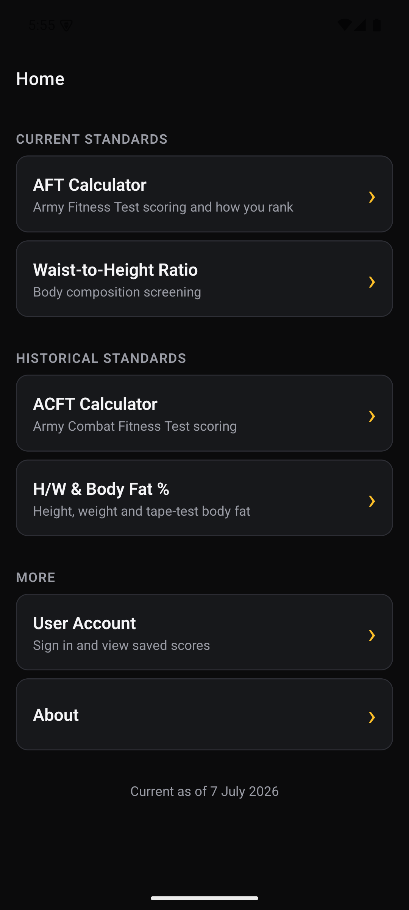
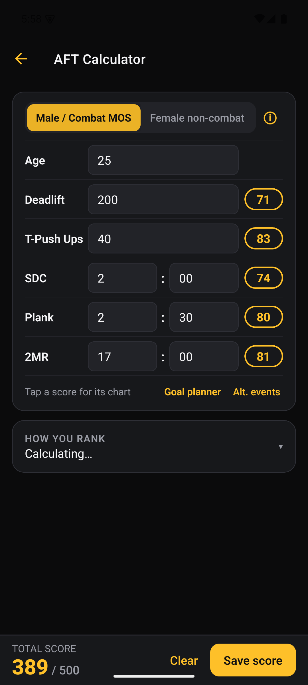
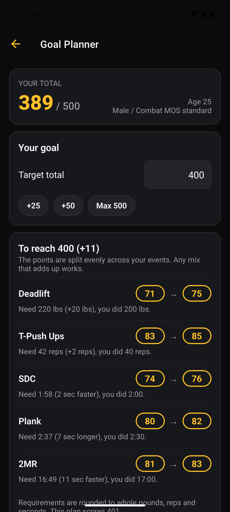

# AFT Score Calculator

Mobile app that scores the U.S. Army Fitness Test (AFT, formerly the ACFT). Enter your age, sex or combat-MOS standard, and your event results; it returns a score for each event and a total, and shows how that score compares with other users. Published on the iOS App Store as [Updated ACFT Score Calculator](https://apps.apple.com/us/app/updated-acft-score-calculator/id1619926227).

<p>  </p>

## Why it exists

Scoring the Army Fitness Test means looking up each event's result in tables that depend on age, sex and standard, then adding the events up, and working out what you still need for a target total is more lookups. This app does the lookups on the device (so it works offline), shows each event score and the total, a goal planner for what each event needs to reach a target, and, with an account, how your score compares with other soldiers' saved results.

## Features

- **AFT Calculator** – event scores and total for the current standards, plus a percentile card (see below)
- **Goal Planner** – given the results you entered, works out what each event needs to reach a target total
- **Waist-to-Height Ratio** – body-composition screening
- **ACFT Calculator** and **Height/Weight & Body Fat %** – the earlier standards, kept for reference
- **Accounts and saved results** – sign in to save scores and view them later
- Runs on a dark theme; on tablets the screens stay in a readable 640px column

The home screen states the standards are "Current as of 7 July 2026".

## Stack

- React Native 0.86 / Expo SDK 57 (JavaScript), React Navigation (native stack)
- `expo-dev-client` for native builds, EAS for build and submit
- `react-native-google-mobile-ads` for the banner ad
- Talks to [ACFTScoreCalculatorBackend](https://github.com/bsav0016/ACFTScoreCalculatorBackend) for accounts, saved results and percentiles

## Running it

```bash
npm install
npm start                # expo start --dev-client
```

This app uses native modules (ads, tracking transparency), so Expo Go will not run it. Build a development client instead:

```bash
npm run android          # expo run:android (needs the Android SDK)
npm run ios              # expo run:ios (needs macOS and Xcode)
```

The `android/` and `ios/` folders are generated by Expo (`expo prebuild`) and are not committed.

The calculators work without a server. Sign-in, saved results and percentiles call the backend at the URL in `components/constants.js`: a local address in development and the production host otherwise. To use your own backend, change `backendUrl` there and run the backend repo locally.

## Tests and checks

```bash
npm test          # scoring tests (Jest, no network)
npm run lint      # ESLint with the Expo config
npm run build:check   # bundles the JavaScript for iOS and Android
```

The same three run on every pull request (`.github/workflows/ci.yml`). They do not compile native code, so a green check does not prove an iOS or Android build will succeed; that is still done with EAS at release time.

The scoring tests are in `tests/`: golden values read by hand from the table cells at each threshold and one step either side, an independent reference scorer checked against every table, column and boundary, structural checks on the tables themselves, a cell-by-cell comparison of all five tables with the Army's published chart (`tests/fixtures/aft-score-tables-250601.txt`, effective 1 June 2025), and the goal planner's reverse lookup. They never call the backend, and one test checks that scoring makes no network request.

## How the scoring works

Official AFT scoring is a set of lookup charts by age bracket and sex or combat-MOS standard. The charts are stored as arrays under `components/Calculator/AFTScores/` (and `components/ACFTCalculator/Scores/` for the old standard). The scripts in `pythonBuilderFiles/` turn charts pasted from the official tables into those arrays, so the data can be regenerated when the Army changes the standards.

## Design decisions

- **Lookup tables, not formulas.** Scores are read from the official charts rather than approximated, so results match the published tables.
- **Chart generation scripts.** Keeping the Python builders in the repo makes updating the tables a repeatable paste-and-run step.
- **Offline-first calculators.** Scoring runs on the device; the server is only used for accounts, saved results and percentiles.
- **Percentile requests have a timeout**, so a slow server doesn't block the calculator.

## Limitations

- Standards are correct only as of the date shown in the app and must be updated by hand.
- The tables are checked against the Army chart effective 1 June 2025. When the Army publishes a new scale, add its figures as a new fixture, regenerate the tables, and point `tests/aftOfficialTables.test.js` at it.

## License

MIT. See [LICENSE](LICENSE).
