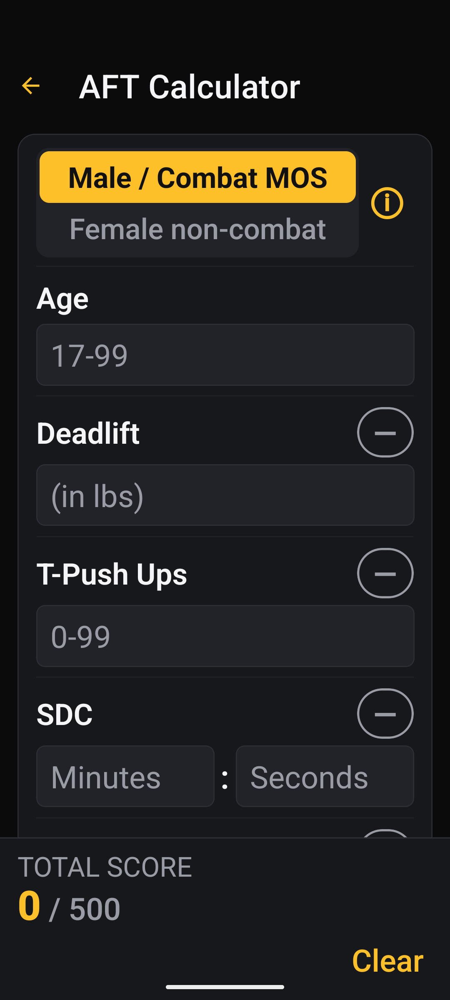

# Accessibility

What the app does for screen readers and large text, how it is kept that way, and the checklist for testing it by hand.

## What is built in

- **Names.** Every text input has an `accessibilityLabel` (the visible label is hidden from the reader so it is not said twice). Timed events are "Sprint drag carry minutes" / "seconds", with spoken names for SDC and 2MR.
- **Roles.** Tappable things are buttons; screen and card titles are headings; field errors are alerts and also the input's hint.
- **Announcements.** On the calculator, about 1.5 seconds after the last change, a screen reader says what changed ("Deadlift 99 points.") and, once all five events are in, the total ("Total 350 of 500."). Pure logic in `components/Calculator/announce.js`; timing and the screen-reader check in `useScoreAnnouncements.js`.
- **Large text.** All text comes from `components/text.js`, which stops scaling at 2x (`MAX_FONT_SCALE`). From 1.3x (`LARGE_TEXT_FROM`) rows stack instead of sitting side by side: calculator rows, goal and measurement fields, the Male/Combat control and the total bar. Contrast already passes (text 18.1:1, muted text 7.2:1, gold 12.0:1, danger 5.8:1, success 8.9:1 on the app background).

*The calculator at font size 2.0 (Android emulator).*

## How it stays that way

- `npm test` renders the calculator and goal planner and fails if an input has no name, a button has no name, text is not capped, or a row does not stack at 2x (`tests/ui/`).
- `npm run lint` fails on a `TextInput` without `accessibilityLabel`, a touchable without `accessibilityRole`, and an import of `Text`/`TextInput` from `react-native` (`scripts/eslint-rule-a11y.js`, `eslint.config.js`). One element opts out with a comment and a reason.
- Component tests do not hear speech or see pixels. The checklist below is what covers that.

## Manual pass (before a release that changes screens)

Run it on an iPhone (VoiceOver) and an Android phone (TalkBack), and tick what you did.

**Calculator**
- [ ] Swipe through the screen: each field is read once, with its name ("Age", "Deadlift", "Sprint drag carry minutes").
- [ ] Type a deadlift: after a pause it says the points. It does not talk over your typing.
- [ ] Fill all five events: the total is said once, with "of 500".
- [ ] "Clear" says nothing confusing; the events read as empty again.
- [ ] Score buttons read "Deadlift score chart, 84 points" and open the chart; the chart closes.
- [ ] Goal planner and Alternate events are announced as buttons and open.
- [ ] The percentile summary is read after the rank loads.

**Goal planner, waist-to-height, account**
- [ ] Each input is named; quick targets read "Set target to 475, plus 25 points".
- [ ] Sign in and registration fields are named; a wrong password error is announced.
- [ ] Saved scores and profile rows read "First name: Ada" with "Double tap to edit".

**Large text** (iOS: Settings > Accessibility > Display & Text Size > Larger Text, max; Android: Settings > Display > Font size, largest)
- [ ] Calculator, planner, results, profile and sign-in: nothing is cut off or overlapping, every button can still be tapped.
- [ ] The total bar and Save score are reachable.
- [ ] Anything that looks wrong: note the screen and the setting.

Last pass: not yet done.
